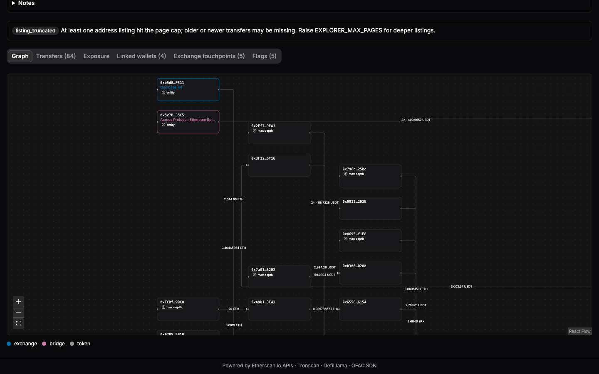
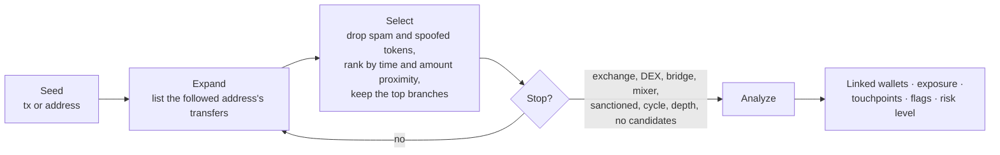

# fund-origin-tracer

[](https://github.com/tarikcaykara/fund-origin-tracer/actions/workflows/ci.yml)
[](https://bun.sh)
[](tsconfig.base.json)
[](LICENSE)

Open-source crypto fund-flow tracer for compliance, fraud and incident-response teams: source and destination of funds, linked wallets and explainable exposure on Ethereum, Polygon, Arbitrum and TRON. Self-hosted, no black-box score.



## Why

Commercial know-your-transaction tools are expensive and return a risk score you cannot inspect. fund-origin-tracer is the opposite: you run it yourself, every followed transfer, dropped candidate and stop reason is visible, and the risk level is the worst severity among explainable flags defined in a policy file you can read and override.

## Who it's for

- **Compliance and AML teams** screening deposits and documenting source of funds.
- **Fraud and risk teams** following stolen or laundered funds to exchange deposit addresses.
- **Security and incident response** mapping where funds went after a hack or phishing event.

## Features

- Backward (source of funds) and forward (destination of funds) tracing from 1–20 seeds, each a transaction hash or an address.
- Ethereum, Polygon, Arbitrum (Etherscan API V2) and TRON (Tronscan).
- Stops at labeled exchanges, DEXes, bridges, mixers, scams and token contracts (only mixers with `traceThroughEntities`), and at sanctioned addresses (OFAC SDN list).
- Linked wallets: addresses reached by more than one seed or branch.
- Exposure to labeled entities by hop distance, and exchange touchpoints with a copyable freeze-request list.
- Explainable flags with severities, overridable per flag through a policy file.
- USD values from DefiLlama; canonical stablecoins are priced 1:1 by contract address, so a spoofed "USDT" is never valued as a dollar. Candidates without a USD price are not followed by default (`followUnpriced` turns that on).
- Live graph (React Flow + ELK) with pause, resume and cancel; expand any stopped edge by hand.
- Exports: JSON and five CSVs (edges, addresses, convergences, exposure, touchpoints); a report page per run.
- REST + SSE API, CLI, and a Docker image.
- Recorded demo scenarios that replay offline, without API keys.

## How it works



On account-based chains there is no input-to-output link between transfers, so every selection is a hypothesis ranked by amount and time proximity, not proof. See [docs/methodology.md](docs/methodology.md).

## Quick start

Requires [Bun](https://bun.sh) 1.4.3.

1. Get free keys (optional; demos need none): an [Etherscan](https://etherscan.io/apis) key covers Ethereum, Polygon and Arbitrum; a [Tronscan](https://tronscan.org) key covers TRON.
2. Set up and run:

   ```bash
   bun install
   cp .env.example .env     # add ETHERSCAN_API_KEY and/or TRONSCAN_API_KEYS
   bun run dev              # API on :3000, web UI on :5173
   ```

3. Open <http://localhost:5173>. Without keys, use a **Run demo** card on the Home page: demos replay recorded API responses offline.

For a production-style run (`bun run build`, then `bun run start`) the server serves the built UI on `PORT`.

## Docker

```bash
cp .env.example .env          # optional: add API keys
docker compose up -d --build  # http://localhost:3000 (override the host port with PORT=3100)
```

The image runs the server only (the web UI is prebuilt into it). Results and the response cache live in the `data` named volume at `/app/data`. Inside the container `PORT` is fixed at 3000 and `DATA_DIR` at `/app/data`; the compose file sets both after reading `.env`, and `PORT` in `.env` only changes the host port.

## CLI

```bash
# Source of funds of a transaction
bun apps/cli/src/main.ts trace --chain ethereum --direction backward --tx 0xe7f7c8836a109082c31d9587904304caa1f004ab056bf5e3b4e40d08d2078f0b

# Several seeds, bounded, as JSON to a file
bun apps/cli/src/main.ts trace --chain tron --direction forward --address <T-address> --address <T-address> \
  --max-depth 6 --max-branches 3 --max-edges 200 --min-usd 100 --timeout 300 --format json --out result.json --quiet

# Linked wallets as CSV; follow tokens without a USD price too
bun apps/cli/src/main.ts trace --chain ethereum --direction backward --tx <hash> --follow-unpriced --format csv --csv-kind convergences

# Screen one address against labels and OFAC
bun apps/cli/src/main.ts screen --chain ethereum <address>

# Validate a local labels file; start the server
bun apps/cli/src/main.ts labels validate my-labels.json
bun apps/cli/src/main.ts serve --port 3000
```

Options: `--max-depth`, `--max-branches`, `--max-edges`, `--min-usd`, `--timeout`, `--through-entities`, `--follow-unpriced`, `--format summary|json|csv`, `--csv-kind edges|convergences|exposure|touchpoints|addresses`, `--out`, `--quiet`; global `--data-dir`, `--labels`, `--policy`. Exit codes: 0 completed, 2 usage error, 3 failed, 4 cancelled or timed out. `bun apps/cli/src/main.ts --help` prints the full usage.

## API

REST endpoints plus an SSE event stream per run, with no authentication (run it on a trusted network). See [docs/api.md](docs/api.md).

## Configuration

Set in `.env` (see `.env.example`). Blank values behave like unset ones.

| Variable | Default | Purpose |
|---|---|---|
| `PORT` | `3000` | HTTP port of the server. |
| `DATA_DIR` | `./data` | Directory for the SQLite database (runs, response cache). |
| `ETHERSCAN_API_KEY` | empty | Etherscan V2 key for Ethereum, Polygon and Arbitrum. |
| `ETHERSCAN_RPS` | `3` | Etherscan requests per second (free tier: 3). |
| `TRONSCAN_API_KEYS` | empty | Tronscan key(s) for TRON, comma-separated; keys rotate. |
| `TRONSCAN_KEY_INTERVAL_MS` | `2000` | Minimum interval between requests per Tronscan key. |
| `TRONSCAN_GLOBAL_INTERVAL_MS` | `500` | Minimum interval between any two Tronscan requests. |
| `EXPLORER_MAX_PAGES` | `2` | Pages fetched per address listing (1–4); deeper listings use more API calls. |
| `ENGINE_CONCURRENCY` | `4` | Edges expanded in parallel per run (1–32). |
| `FOT_LABELS_PATH` | empty | Path to your local labels JSON file. |
| `FOT_POLICY_PATH` | empty | Path to your risk-policy override JSON file. |
| `OFAC_SDN_URL` | `https://sanctionslistservice.ofac.treas.gov/api/publicationpreview/exports/sdn.xml` | Source of the sanctions list. |
| `OFAC_REFRESH_HOURS` | `24` | How often the sanctions list is refreshed. |
| `DEMO_ONLY` | `false` | When `true`, only recorded demos can run (no live traces); for public deployments. |

## Labels

Labels name addresses (exchange, DEX, bridge, mixer, scam, ...). Bundled labels live in `packages/core/labels/<chain>.json`; every entry cites a public source URL that was opened and verified. Add private labels without touching the repo by pointing `FOT_LABELS_PATH` at a local file; it overrides bundled entries for the same address. Absence of a label means "unknown", not "clean". To contribute a label, include the source URL: see [docs/labels.md](docs/labels.md) and [CONTRIBUTING.md](CONTRIBUTING.md).

## Risk policy

The risk level (`high`, `medium`, `low`) is the worst severity among raised flags; `low` and `info` flags never raise it. Defaults from `packages/core/src/policy/default-policy.json`:

| Flag | Severity | Parameters | Raised when |
|---|---|---|---|
| `sanctioned_exposure` | high | | An edge endpoint is OFAC-listed or labeled sanctioned |
| `mixer_direct` | high | `directHops` 1 | Mixer within `directHops` hops |
| `mixer_indirect` | medium | `directHops` 1 | Mixer further than `directHops` hops |
| `scam_direct` | high | `directHops` 1 | Scam address within `directHops` hops |
| `scam_indirect` | medium | `directHops` 1 | Scam address further than `directHops` hops |
| `common_source_across_seeds` | medium | | A source shared by more than one seed |
| `common_source_within_trace` | low | | An address reached by more than one branch |
| `cycle` | medium | | A path loops back on itself |
| `funnel` | medium | `minSenders` 4, `windowSec` 86400 | Many distinct senders into one address within a window |
| `round_trip` | medium | `tolerance` 0.03 | Same asset and about the same amount returns on one path |
| `structuring` | low | `minAddresses` 5, `maxUsd` 100 | Many unlabeled addresses each with one small transfer |
| `long_chain` | low | `hops` 5 | A long chain with no labeled entity within `hops` hops |
| `unresolved_majority` | low | `share` 0.5 | Most of the terminal value ends at unresolved addresses |
| `exchange_origin` | info | | Funds originate at an exchange |
| `spoofed_tokens_ignored` | info | | Spoofed tokens were dropped |
| `incomplete_trace` | info | | The run did not complete, or a fetch failed |

Override per flag and per setting with a JSON file at `FOT_POLICY_PATH` (or `--policy`); unknown ids and out-of-range values are rejected at boot:

```json
{
  "version": 1,
  "flags": {
    "cycle": { "severity": "off" },
    "structuring": { "severity": "medium", "minAddresses": 8, "maxUsd": 250 },
    "mixer_indirect": { "severity": "high", "directHops": 3 }
  }
}
```

## Methodology & limitations

Scoring constants, drop and stop reasons, swap-through, and the exact flag definitions are in [docs/methodology.md](docs/methodology.md). Key limits: selection is heuristic; account-model chains cannot prove exact attribution; free API tiers cap listings (`listing_truncated`); TRON swap-through works for seed transactions only; BSC, Base and OP are not supported (paid Etherscan tier).

## Data sources & attribution

Powered by Etherscan.io APIs (Ethereum, Polygon, Arbitrum), Tronscan (TRON), DefiLlama (USD prices) and the OFAC SDN list (sanctions).

## Disclaimer

Results are heuristic analysis of public blockchain data, not legal advice, and not an accusation against any person or entity. Labels can be stale or wrong. This project has no affiliation with Etherscan, Tronscan, DefiLlama, OFAC or any exchange named in labels or results.

## License

[MIT](LICENSE)
